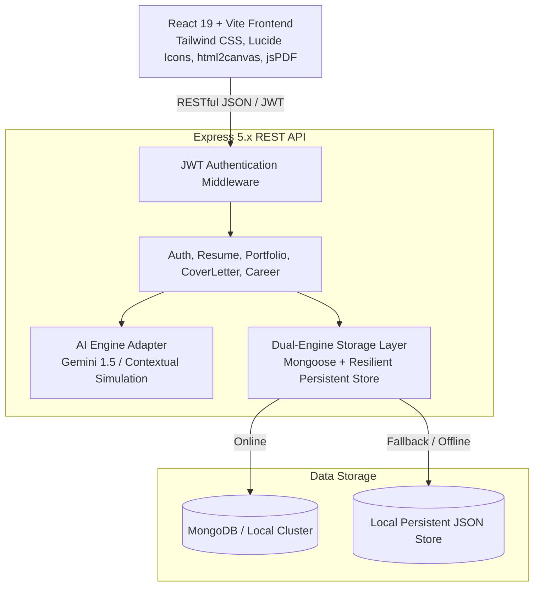

# AI Career Builder – AI-Powered Resume, Portfolio, Cover Letter & Career Platform

[](https://react.dev/)
[](https://nodejs.org/)
[](https://expressjs.com/)
[](https://www.mongodb.com/)
[](https://tailwindcss.com/)
[](https://ai.google.dev/)

A full-stack, enterprise-grade **MERN (MongoDB, Express.js, React.js, Node.js)** platform engineered to empower college students and job seekers with ATS-optimized resumes, auto-generated developer portfolios, personalized cover letters, and data-driven career roadmaps.

---

## 📌 Table of Contents
1. [Project Abstract](#-project-abstract)
2. [Problem Statement](#-problem-statement)
3. [Objectives](#-objectives)
4. [Existing System vs. Proposed System](#-existing-system-vs-proposed-system)
5. [System Architecture](#-system-architecture)
6. [Technology Stack](#-technology-stack)
7. [Core Modules & Features](#-core-modules--features)
8. [Installation & Setup Guide](#-installation--setup-guide)
9. [Execution Instructions](#-execution-instructions)
10. [RESTful API Specification](#-restful-api-specification)
11. [Evaluation & Demonstration Walkthrough](#-evaluation--demonstration-walkthrough)
12. [Future Enhancements](#-future-enhancements)

---

## 📄 Project Abstract

In today's hyper-competitive tech recruitment landscape, more than **75% of resumes are filtered out by automated Applicant Tracking Systems (ATS)** before reaching human recruiters. Furthermore, technical candidates struggle to present cohesive digital footprints, lacking portfolio websites and customized cover letters tailored to specific job specifications.

**AI Career Builder** addresses this challenge through an intelligent, unified MERN stack platform. It enables job seekers to generate and audit **ATS-compliant resumes** across multiple parse-tested layouts, build responsive **developer portfolios** with 1-click **standalone static HTML export**, draft customized **cover letters**, and receive personalized **4-phase career learning roadmaps** with granular skill gap diagnosis.

---

## 🚨 Problem Statement

1. **High ATS Rejection Rates**: Unstructured layouts, graphics, multi-column tables, and missing keyword density cause automated parsers (e.g., Taleo, Workday, BrassRing) to misread candidate qualifications.
2. **Fragmented Job Application Workflow**: Candidates spend days switching between word processors, portfolio builders, and manual application forms with inconsistent branding.
3. **Impersonal Cover Letters**: Generic, repetitive templates fail to articulate how a candidate's distinct competencies match employer requirements.
4. **Lack of Clear Career Trajectories**: Students lack structured diagnostic feedback to understand which specific skills they are missing for their target engineering roles.

---

## 🎯 Objectives

- Architect an intuitive, end-to-end MERN application built with modern React 19, Vite, Express, and MongoDB.
- Provide real-time ATS scoring (0–100%) and actionable keyword recommendations.
- Enable live multi-template resume customization (Modern ATS, Executive, Tech Clean) with direct client-side PDF export.
- Generate personal developer portfolio sites with live viewport simulation (Desktop, Tablet, Mobile) and standalone static HTML export.
- Implement an AI Cover Letter Engine that aligns candidate background with target job roles.
- Provide a structured 4-Phase Learning Roadmap identifying skill matches and missing competencies.
- Ensure 100% academic transparency with configurable AI keys and high-fidelity contextual simulation when operating in offline/demo mode.

---

## ⚖️ Existing System vs. Proposed System

| Feature Dimension | Existing Traditional Methods | AI Career Builder (Proposed) |
|---|---|---|
| **Resume Formatting** | Arbitrary Word/Canva templates frequently scrambled by ATS | Semantic, clean layouts engineered specifically for algorithmic parsing |
| **Keyword Optimization** | Manual guesswork by candidate | Dynamic ATS score analysis & missing keyword suggestions |
| **Portfolio Creation** | Requires separate coding, hosting, and DNS setup | Real-time generator with 1-click downloadable static HTML website |
| **Cover Letter Writing** | Generic copy-pasted cover letters | Contextual 4-paragraph letter tailored to target company and role |
| **Career Guidance** | Generic, unorganized internet search results | 4-Phase structured milestone roadmap with curated learning topics |
| **Database Persistence** | Fragmented local file saves | Centralized MongoDB database with user-isolated collections |

---

## 🏗️ System Architecture



---

## 💻 Technology Stack

### Frontend
- **Framework**: React.js (v19.x) with Vite 8.x
- **Routing**: React Router DOM (v7.x)
- **Styling**: Tailwind CSS (v4.x) with custom Glassmorphism tokens
- **Icons**: Lucide React
- **HTTP Client**: Axios with JWT request & response interceptors
- **Export Engines**: `jspdf` & `html2canvas` for client-side PDF compilation; `canvas-confetti` for celebratory UX micro-interactions

### Backend
- **Runtime**: Node.js (v24.x LTS)
- **Web Framework**: Express.js (v5.x)
- **Database ODM**: Mongoose (v9.x)
- **Security**: `bcryptjs` (10-round salted password hashing) & `jsonwebtoken` (JWT stateless auth)
- **Persistence Fallback**: Smart storage engine enabling seamless full-CRUD operations under both active MongoDB instances and zero-config local persistent datastore.

### AI Engine Integration
- **Configurable Live Providers**: Google Gemini 1.5 Pro / Flash & OpenAI API via backend environment variables.
- **Academic Simulation Engine**: Realistic domain-specialized fallback engine with zero downtime and explicit `[Demo AI Mode]` badge tags.

---

## 🌟 Core Modules & Features

### 1. Landing Page (`/`)
- Sleek SaaS design with indigo/purple/slate gradients and responsive hero banner.
- Real-time statistics counters (98.4% ATS Pass Rate, 1-Click Export, 100% Free).
- Interactive feature showcase, step-by-step workflow timeline, and side-by-side comparison table.
- **1-Click Student Demo Login** button for instant evaluation without typing credentials.

### 2. User Authentication & Profile (`/login`, `/register`, `/profile`)
- Secure registration and login with bcrypt password encryption.
- JWT token management with auto-logout on token expiration.
- Profile settings allowing updates to technical skills, target role, bio, and passwords.

### 3. User Dashboard (`/dashboard`)
- Metric summary cards: Resumes Created, Portfolios Built, Cover Letters Written, and Average ATS Score.
- Quick launcher shortcuts to all generation tools.
- Real-time document feed with direct Edit, Preview, and Delete capabilities.
- Live AI Career Target readiness gauge.

### 4. AI ATS Resume Builder (`/resume-builder`)
- Input categories: Personal info, professional summary, education, technical skills, work experience, engineering projects, certifications, and achievements.
- Dynamic entry controls (add/remove multiple positions, projects, degrees, action bullets).
- **AI Summary Generator**: Crafts tailored summaries using action verbs and technical keywords.
- **ATS Score Audit**: Live score gauge (0–100%) checking keyword density and structural compliance.
- **3 Parse-Tested Templates**: Modern ATS Clean, Executive Professional, and Tech Clean.
- **PDF Export**: Print-accurate vector PDF download.

### 5. AI Portfolio Website Builder (`/portfolio-builder`)
- Auto-compiles portfolio from user details (Hero, About, Skills, Projects, Experience, Contact).
- **3 Color Themes**: Indigo Glow, Cyber Dark, and Minimal Light.
- **Device Viewport Simulator**: Interactive Desktop, Tablet, and Mobile preview toggles.
- **Export Standalone Static HTML Website**: Downloads a complete, self-contained single-page website ready to deploy to GitHub Pages or Netlify.

### 6. AI Cover Letter Generator (`/cover-letter`)
- Tailored application writer using applicant background, company name, job title, and pasted job description.
- Tone selection: Professional & Confident, Enthusiastic & Passionate, Concise & Direct, Creative.
- Direct copy to clipboard with toast notification, rich editing, and PDF download.

### 7. AI Career Recommendation System (`/career-advisor`)
- Analyzes degree, major, technical competencies, and career interests.
- Generates top-matching career tracks with match percentages, salary estimates, and demand indices.
- Side-by-side **Matching Skills** vs **Critical Missing Skills** tags.
- Personalized **16-Week 4-Phase Learning Roadmap** (Foundations, Architecture, DevOps/Cloud, Capstone/Interviews).

### 8. Saved Documents Repository (`/saved-documents`)
- Unified document hub with category filters (All, Resumes, Portfolios, Cover Letters).
- Direct Edit, View, and Delete operations synced with MongoDB.

---

## 🚀 Installation & Setup Guide

### Prerequisites
- **Node.js**: v18.x or higher (`node -v`)
- **npm**: v9.x or higher (`npm -v`)
- **MongoDB** *(Optional)*: Local MongoDB instance or MongoDB Atlas URI (Application features automatic resilient persistence fallback if MongoDB is not present locally).

### Step 1: Clone or Navigate to Project
```bash
cd "c:\Users\Dell\sabaree fsd\ai-career-builder"
```

### Step 2: Install Backend Dependencies
```bash
cd backend
npm install
```

### Step 3: Install Frontend Dependencies
```bash
cd ../frontend
npm install
```

### Step 4: Configure Environment Variables
Inside `backend/.env`:
```env
PORT=5000
NODE_ENV=development
MONGO_URI=mongodb://127.0.0.1:27017/ai_career_builder
JWT_SECRET=supersecret_jwt_key_career_builder_2026_fsd
JWT_EXPIRE=7d

# Optional AI Key (Google Gemini / OpenAI)
AI_PROVIDER=gemini
GEMINI_API_KEY=your_gemini_api_key_here
```
*(If no API key is provided, the platform automatically activates its high-fidelity Contextual Simulation Engine with full features active).*

---

## ⚡ Execution Instructions

### Running the Backend Server
```bash
cd backend
npm run dev
```
*Backend initializes at: `http://localhost:5000`*

### Running the Frontend Application
```bash
cd frontend
npm run dev
```
*Frontend interface accessible at: `http://localhost:5173`*

---

## 📡 RESTful API Specification

| Method | Endpoint | Access | Description |
|---|---|---|---|
| `GET` | `/api/health` | Public | System status, database mode, and AI engine status |
| `POST` | `/api/auth/register` | Public | Register new user account |
| `POST` | `/api/auth/login` | Public | Authenticate user & issue JWT |
| `POST` | `/api/auth/demo` | Public | **Instant 1-Click Student Demo Login** |
| `GET` | `/api/auth/profile` | Private | Retrieve authenticated user profile |
| `PUT` | `/api/auth/profile` | Private | Update user details, skills, or password |
| `GET` | `/api/resumes` | Private | Retrieve all resumes for current user |
| `POST` | `/api/resumes` | Private | Create resume & compute ATS audit |
| `POST` | `/api/resumes/ai/summary` | Private | AI-generate high-impact resume summary |
| `POST` | `/api/resumes/ai/review` | Private | Run ATS score and keyword diagnosis |
| `PUT` | `/api/resumes/:id` | Private | Update resume & recalculate score |
| `DELETE` | `/api/resumes/:id` | Private | Remove resume record from database |
| `GET` | `/api/portfolios` | Private | Retrieve user portfolios |
| `POST` | `/api/portfolios` | Private | Create and store portfolio |
| `GET` | `/api/portfolios/:id/export-html` | Public | **Export standalone static HTML portfolio** |
| `POST` | `/api/cover-letters/ai/generate` | Private | Generate tailored AI cover letter |
| `POST` | `/api/cover-letters` | Private | Save cover letter to database |
| `POST` | `/api/career/analyze` | Private | Run AI career recommendation & 4-phase roadmap |
| `GET` | `/api/career/latest` | Private | Fetch latest saved career recommendations |

---

## 🎓 Evaluation & Demonstration Walkthrough

When presenting to faculty and evaluators, use the following sequence for demonstration:

1. **Visit `http://localhost:5173`**:
   - Showcase the modern landing page, responsive navbar, and metrics.
2. **One-Click Demo Login**:
   - Click **'Quick Demo Login'** in the navbar or hero. This bypasses tedious manual typing and authenticates as pre-configured candidate **Alex Rivera**.
3. **Explore Dashboard (`/dashboard`)**:
   - Point out real-time stats, saved document counters, and the system health badge.
4. **Demonstrate ATS Resume Builder (`/resume-builder`)**:
   - Show the split-screen editor and real-time document preview.
   - Click **'AI Generate Summary'** to watch the AI engine compose an executive summary.
   - Click **'ATS Score'** to view the live audit results (strengths, recommendations, score).
   - Toggle templates: Switch from **Modern ATS** to **Executive** or **Tech Clean**.
   - Click **'Save to DB'**, followed by **'Download PDF'** to demonstrate client-side vector PDF generation.
5. **Demonstrate Portfolio Builder (`/portfolio-builder`)**:
   - Switch themes between **Indigo Glow**, **Cyber Dark**, and **Minimal Light**.
   - Toggle the viewport buttons to show **Tablet** and **Mobile** simulator modes.
   - Click **'Export Static HTML Website'** — open the downloaded `.html` file directly in a browser to prove it operates as a self-contained website!
6. **Demonstrate Cover Letter AI (`/cover-letter`)**:
   - Click **'Preload Demo Role'**, then click **'Generate AI Cover Letter'**.
   - Demonstrate the **'Copy'** button and **'PDF'** download.
7. **Demonstrate Career Advisor (`/career-advisor`)**:
   - Click **'Generate Career Recommendations & Roadmap'**.
   - Review matching percentage cards, missing skill gap indicators, and the **16-Week 4-Phase Learning Roadmap**.
8. **Demonstrate Saved Documents (`/saved-documents`)**:
   - Show all persisted documents stored in the database.

---

## 🔮 Future Enhancements

- **Direct GitHub Sync**: Automatic repository fetching to populate projects in real-time.
- **LinkedIn One-Click Import**: Parsing existing LinkedIn PDF exports directly into resume fields.
- **Interview Mock Simulator**: Real-time AI voice technical interviews based on career roadmap milestones.
- **Custom Domain Deployment**: Automated Netlify / Vercel API webhooks to publish portfolios to live URLs.

---

## 👨‍💻 Author & Project Credits
- **Project**: AI Career Builder (Full Stack Development Capstone)
- **Course**: Full Stack Web Development (FSD)
- **Technologies**: React 19, Node.js, Express, MongoDB, Tailwind CSS, Google Gemini Pro API
- **License**: MIT
